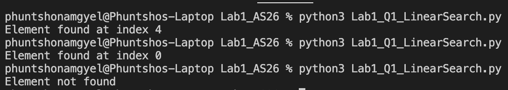
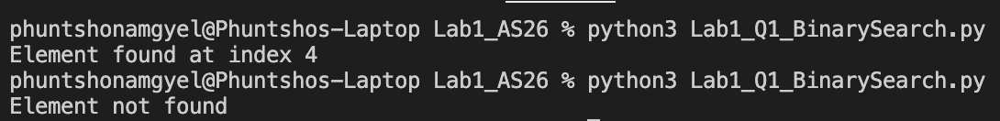
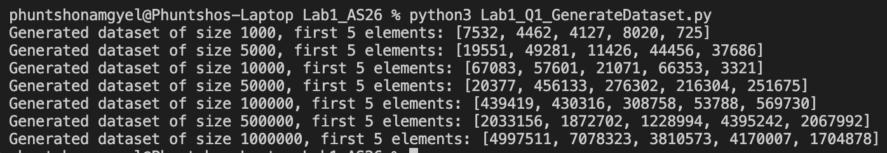
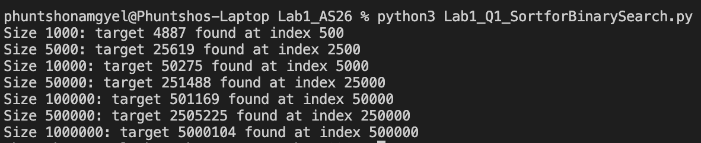
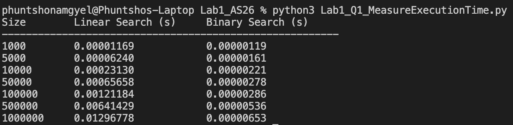
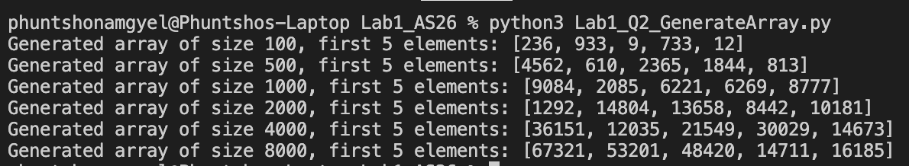
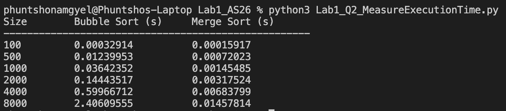
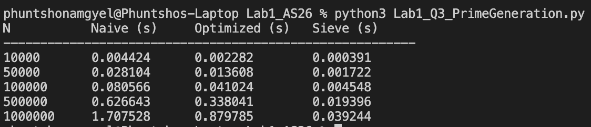

## Lab: Empirical Growth Rate Measurement and Algorithm Benchmarking

### Question 1.1

### Question 1.2

### Question 1.3

### Question 1.4

### Question 1.5

### Question 2.1

### Question 2.2

### Question 2.3

### Question 2.4

### Question 3
